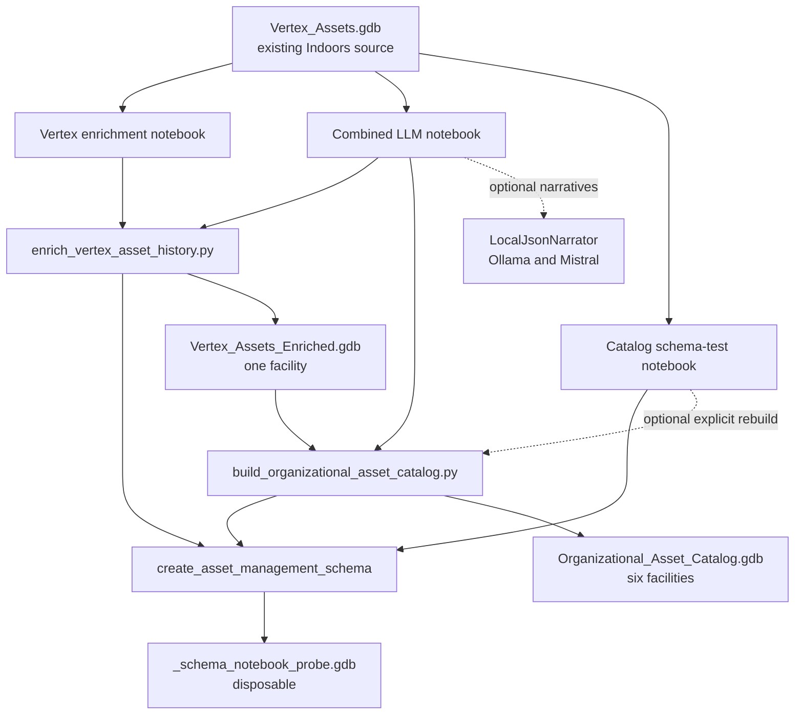
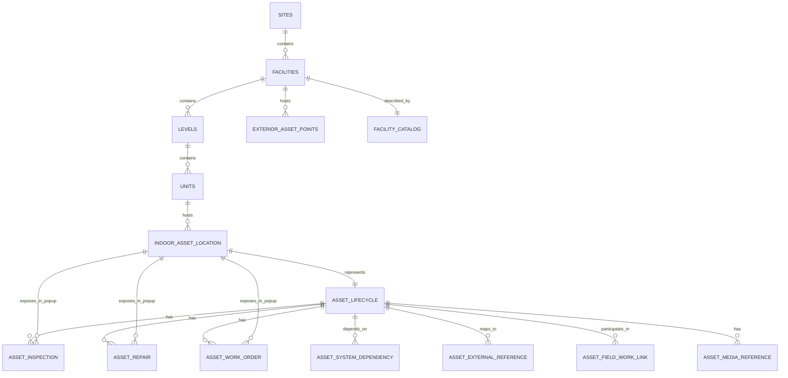
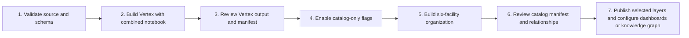

# ArcGIS Pro Notebook and Asset Database Workflows

This guide explains what each ArcGIS Pro notebook does, which Python scripts it calls, how generated assets attach to the ArcGIS Indoors model, and whether an output covers Vertex Medical Center or the full synthetic organization. Read [Catalog and Enrichment Guide](catalog_and_enrichment_guide.md) first for the overall data flow.

## Quick Answer

The notebooks do not all produce the same database.

| Goal | Notebook to run | Result |
| --- | --- | --- |
| Test Vertex enrichment with Ollama and Mistral | `scripts/run_llm_asset_enrichment_in_arcgis_pro.ipynb` with its defaults | Vertex-only `Vertex_Assets_Enriched.gdb` |
| Build Vertex without mandatory Ollama preflight | `scripts/enrich_vertex_asset_history_in_arcgis_pro.ipynb` | Vertex-only `Vertex_Assets_Enriched.gdb` |
| Build the complete organization with LLM narratives | `scripts/run_llm_asset_enrichment_in_arcgis_pro.ipynb` with the catalog flags enabled | Six-facility `Organizational_Asset_Catalog.gdb` |
| Test schema creation in ArcGIS Pro | `scripts/test_catalog_schema_in_arcgis_pro.ipynb` | Disposable `_schema_notebook_probe.gdb`; later optional cells can verify or explicitly rebuild the organization catalog |

Do not run both Vertex production notebooks for the same output. They are alternative entry points and both target `Vertex_Assets_Enriched.gdb`.

## End-to-End View



The original `Vertex_Assets.gdb` is always treated as read-only. Each production workflow creates a separate file geodatabase and remaps GlobalID relationships inside that output.

## Notebook Responsibilities

### Combined LLM Notebook

File: `scripts/run_llm_asset_enrichment_in_arcgis_pro.ipynb`

This is the recommended operator notebook when Ollama narratives are wanted. It performs these stages:

1. Inspects the ArcGIS Pro Python environment.
2. Finds the Ollama Windows executable, including its standard per-user location when `PATH` is stale.
3. Checks the localhost Ollama service.
4. Confirms that `mistral` is installed.
5. Sends a strict JSON narrative probe before any geodatabase write.
6. Loads both the Vertex enrichment and organization catalog builders.
7. Runs only the workflows enabled by its flags.
8. Validates narrative telemetry and removes partial Vertex output after failure.

The checked-in notebook is currently configured for the completed catalog-only run:

```python
RUN_VERTEX = False
RUN_CATALOG = True
ALLOW_OVERWRITE = True
```

These settings reuse the reviewed Vertex enrichment and build or recover the organization catalog. Change flags deliberately for the intended output; do not run both production paths against the same output concurrently.

To regenerate the full organization after reviewing Vertex, use:

```python
RUN_VERTEX = False
RUN_CATALOG = True
ALLOW_OVERWRITE = True
```

That second configuration invokes `build_organizational_asset_catalog.py` and replaces the existing organization catalog. It requires the reviewed `Vertex_Assets_Enriched.gdb`; the builder imports its 1,003 Vertex assets and history before generating the other five facilities. Review and close any ArcGIS layers or tables that hold locks before enabling overwrite.

### Vertex Enrichment Notebook

File: `scripts/enrich_vertex_asset_history_in_arcgis_pro.ipynb`

This is a narrower alternative to the combined notebook. It:

- Reads the existing Vertex Indoors hierarchy and asset records.
- Creates `Vertex_Assets_Enriched.gdb`.
- Adds lifecycle, inspection, repair, work-order, warranty, cost, vendor, maintenance, and risk data.
- Uses deterministic narratives by default.
- Can use the localhost narrator if `LLM_ENDPOINT` and `LLM_MODEL` are configured manually.
- Requires explicit overwrite consent and deletes partial output after a failed run.

This notebook is **Vertex-only**. It never creates Point Place, Line Lake, Node North, Rohdran Cove, or Admin HQ.

### Catalog Schema-Test Notebook

File: `scripts/test_catalog_schema_in_arcgis_pro.ipynb`

This notebook primarily isolates the ArcPy schema-creation boundary that was unstable in a standalone Python process. It:

- Creates the disposable `_schema_notebook_probe.gdb`.
- Copies only the minimum Indoors hierarchy needed for the test.
- Creates the generator-owned asset schema.
- Verifies required datasets, domains, and relationships.

Later cells inspect the existing organization catalog. They can invoke the organization builder only when `FORCE_REBUILD = True`. With the default `False`, an existing catalog and manifest are preserved. This notebook is a diagnostic and verification tool, not the preferred production runner.

## Scope Matrix

| Component | Vertex only | Full organization | Writes production data | Primary purpose |
| --- | :---: | :---: | :---: | --- |
| `run_llm_asset_enrichment_in_arcgis_pro.ipynb` | Yes, by default | Yes, when catalog flags are enabled | Yes | Ollama preflight and controlled orchestration |
| `enrich_vertex_asset_history_in_arcgis_pro.ipynb` | Yes | No | Yes | Focused Vertex enrichment |
| `test_catalog_schema_in_arcgis_pro.ipynb` | Uses Vertex as schema source | Can verify or explicitly rebuild catalog | Probe by default; optional catalog rebuild | ArcGIS Pro schema diagnosis |
| `enrich_vertex_asset_history.py` | Yes | No | Yes | Vertex writer used by both production notebooks |
| `build_organizational_asset_catalog.py` | Includes Vertex | Yes | Yes | Six-facility hierarchy, assets, history, and validation |
| `check_local_llm.py` | No geodatabase scope | No geodatabase scope | No | One-request LLM contract test |
| Python toolbox `Generate Demo Assets` | Any selected single source GDB | Not automatically | Yes, to a copied output | Profile-driven generation for one supplied Indoors source |
| Python toolbox `Integrate Generated Assets` | Depends on selected inputs | Not automatically | Yes, to a new integrated output | Merge generated asset records into a copied target Indoors GDB |

## Full Organization Composition

`build_organizational_asset_catalog.py` creates one standalone synthetic organization geodatabase containing six facilities:

| Facility | Type | Hierarchy source | Profile | Levels | Rooms |
| --- | --- | --- | --- | ---: | ---: |
| Vertex Medical Center | Hospital | Original Vertex hierarchy | Vertex | 5 | 286 |
| Point Place | Hospital | Procedural corridor-and-room plan | Hospital | 5 | 114 |
| Line Lake | Hospital | Procedural corridor-and-room plan | Hospital | 5 | 114 |
| Node North | Hospital | Procedural corridor-and-room plan | Hospital | 5 | 120 |
| Rohdran Cove | Hospital | Procedural corridor-and-room plan | Hospital | 5 | 128 |
| Admin HQ | Business Center | Procedural corridor-and-room plan | Government Office | 7 | 263 |
| **Total** |  |  |  | **32** | **1,025** |

The five generated facilities use deterministic, dependency-free rectangular floor plans with perimeter rooms and a central corridor. Dimensions, rotations, room IDs, room names, and room programs are stable for each Facility. ArcPy places each plan at its synthetic geographic anchor and scales it inside the translated Site. No additional floor-plan input or geometry library is required.

The promoted catalog contains 4,852 indoor lifecycle assets: 1,003 preserved Vertex assets plus 3,849 generated assets. It also contains 72 exterior assets. The validated lifecycle cohorts are 970 recently installed, 2,426 within service life, and 1,456 retrofit/replacement. Its manifest records 20,376 inspections, 922 repairs, 1,913 work orders, 6,590 system-dependency links, and zero orphan references.

## Connection to the ArcGIS Indoors Model

The generated asset model extends ArcGIS Indoors; it does not replace the Indoors hierarchy.



| Layer | Ownership | Role |
| --- | --- | --- |
| `Indoors/Sites` | ArcGIS Indoors | Campus or site parent |
| `Indoors/Facilities` | ArcGIS Indoors | Building parent and exterior-asset anchor |
| `Indoors/Levels` | ArcGIS Indoors | Floor hierarchy |
| `Indoors/Units` | ArcGIS Indoors | Room polygons whose `USE_TYPE` selects asset templates |
| `AssetManagement/IndoorAssetLocation` | Generator | Point representing an asset hosted by a Unit |
| `AssetManagement/ExteriorAssetPoints` | Generator | Exterior or attached asset point hosted by a Facility |
| `AssetLifecycle` | Generator | One authoritative lifecycle record per indoor asset point |
| `AssetInspection`, `AssetRepair`, `AssetWorkOrder` | Generator | One-to-many operational history |
| `FacilityCatalog` | Organization builder | One metadata row per facility; not added by Vertex-only enrichment |
| `AssetSystemDependency` | Organization builder | Graph-ready links to systems such as HVAC, electrical, and IT |
| Integration and media tables | Generator | Empty link contracts until real external IDs or media are supplied |

The lifecycle relationship chain for an indoor asset is:

```text
Site -> Facility -> Level -> Unit -> IndoorAssetLocation -> AssetLifecycle -> history records
```

Inspections, repairs, and work orders also carry `AssetPointGlobalID`, creating direct one-to-many relationships from `IndoorAssetLocation` to each history table. This parallel path supports related-record elements in map popups. Publish the asset layer, history tables, and relationship classes together, then add the desired related-record elements to the popup configuration.

ArcGIS GlobalIDs and GUID foreign keys are authoritative for relationships. Business fields such as `Site_ID`, `Facility_ID`, `Level_ID`, `Unit_ID`, and `Asset_ID` remain available for dashboards, labels, filtering, import/export, and knowledge-graph keys.

## What Each Production Path Adds

| Capability | Vertex enriched output | Organization catalog |
| --- | :---: | :---: |
| Existing Vertex Sites, Facilities, Levels, and Units | Copied | Copied as the first facility |
| Existing 1,003 Vertex lifecycle assets | Enriched | Imported exactly from the enriched output; relationship GUIDs are remapped |
| Four additional hospitals | No | Yes |
| Seven-floor Admin HQ | No | Yes |
| Inspection, repair, and work-order history | Yes | Yes |
| Vendor, purchase, warranty, maintenance cost, and risk | Yes | Organization builder has its own catalog enrichment contract |
| `FacilityCatalog` | No | Yes |
| `AssetSystemDependency` | No | Yes |
| Local LLM narratives | Optional | Optional |
| Manifest and validation summary | Yes | Yes |

The two outputs answer different questions:

- `Vertex_Assets_Enriched.gdb` is the controlled single-facility proof that the existing 1,003 Vertex assets can receive realistic history and planning attributes.
- `Organizational_Asset_Catalog.gdb` is the scaled demonstration dataset for cross-facility dashboards, comparisons, related records, and asset knowledge-graph workflows.

They are separate outputs. The organization builder reads but never modifies `Vertex_Assets_Enriched.gdb`, imports that reviewed Vertex slice into a new catalog, and generates the other facilities around it. The Vertex enrichment notebook does not update `Organizational_Asset_Catalog.gdb`.

For a Vertex-only Indoors demonstration, use `Vertex_Assets_Enriched.gdb` directly. In the organization catalog, `Facility_ID = 'VMC'` isolates the same 1,003 indoor assets and lifecycle records; related inspections, repairs, and work orders remain available through the direct `IndoorAssetLocation` relationship classes. The catalog validator compares imported Vertex business values, geometry, dates, costs, conditions, and narratives with the standalone enriched output after relationship GUID remapping.

## Role of the LLM

Ollama and Mistral affect narrative fields only. Deterministic Python remains authoritative for:

- Facility and asset identities.
- Geometry and Indoors parentage.
- Lifecycle cohorts and dates.
- Conditions, criticality, costs, warranty, and risk.
- Inspections, repairs, work orders, and relationships.

The model receives bounded synthetic facts and may write short inspection, repair, or work-order text. Invalid, unavailable, oversized, or over-budget responses use deterministic fallback text. The output manifest records accepted responses and fallback categories.

## Recommended Build Sequence



1. Open `scripts/run_llm_asset_enrichment_in_arcgis_pro.ipynb` in ArcGIS Pro.
2. Keep `RUN_VERTEX = True`, `RUN_CATALOG = False`, and `ALLOW_OVERWRITE = False` for the first run.
3. Review `Vertex_Assets_Enriched.gdb` and its manifest.
4. Keep the reviewed `Vertex_Assets_Enriched.gdb` in the output directory. For the organization build, set `RUN_VERTEX = False`, `RUN_CATALOG = True`, and `ALLOW_OVERWRITE = True` only after confirming that replacement of the existing catalog is intended. The notebook validates the Vertex dependency, builds and validates a staging catalog, then atomically renames workspaces to replace the prior catalog. It reuses a complete validated staging catalog after a failed promotion instead of rebuilding it.
5. Review `FacilityCatalog`, `AssetLifecycle`, history tables, system dependencies, and the organization manifest before publishing.

Before catalog promotion, remove layers and standalone tables that reference the existing `Organizational_Asset_Catalog.gdb`, close its attribute tables, and close Catalog views browsing inside it. ArcGIS Pro schema locks prevent replacement even after the build itself succeeds. If promotion reports a lock and the kernel is still active, close those references and rerun only the final workflow cell. After restarting ArcGIS Pro, rerun the setup and function-definition cells before the final workflow cell; the notebook will validate and reuse `Organizational_Asset_Catalog_building.gdb`.

Use `test_catalog_schema_in_arcgis_pro.ipynb` only when diagnosing schema creation or verifying the existing organization catalog. It is not a prerequisite for every successful production run.

## Important Boundaries

- No notebook modifies `Vertex_Assets.gdb`.
- Vertex-only outputs contain one facility, not the larger organization.
- The organization output contains Vertex plus four synthetic hospitals and Admin HQ.
- The organization catalog is a self-contained synthetic Indoors geodatabase, not an in-place update to an enterprise Indoors database.
- The toolbox `Generate Demo Assets` operates on one supplied Indoors source at a time; it does not automatically construct the six-facility organization.
- The toolbox `Integrate Generated Assets` copies a selected target and remaps generated records into the new copy; it does not alter either input.
- Utility-network assets, live enterprise IDs, credentials, hosted forms, and image binaries remain outside the current generated scope.
