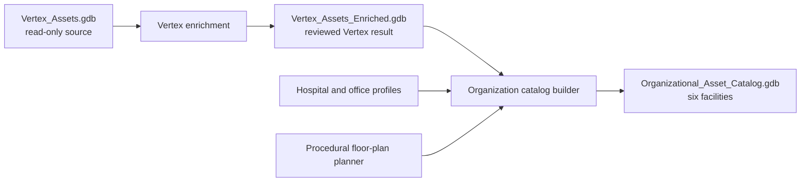

# Catalog and Enrichment Guide

This guide explains the project from source data through the final organizational catalog. It is the best starting point for a new operator, reviewer, or external collaborator.

## What the Project Produces

The project works with three separate file geodatabases. They have different purposes and none is updated in place.

| Geodatabase | Scope | How it is used |
| --- | --- | --- |
| `Vertex_Assets.gdb` | Original Vertex Medical Center source | Read-only input containing the ArcGIS Indoors hierarchy and 1,003 generated asset locations; its history tables are empty |
| `Vertex_Assets_Enriched.gdb` | Vertex Medical Center only | Reviewed enrichment output containing the same 1,003 assets plus lifecycle planning and operational history |
| `Organizational_Asset_Catalog.gdb` | Six-facility organization | Final catalog containing the reviewed Vertex slice plus five procedurally generated facilities |

The outputs are intentionally separate. Vertex enrichment proves that an existing Indoors facility can receive consistent asset-management history. The organization catalog scales that model for dashboards, comparisons, related records, and knowledge-graph demonstrations.



## What Enrichment Means

Enrichment does not modify the original Indoors source. The workflow copies the source to a new geodatabase, creates the asset-management schema, and adds synthetic but internally consistent planning and history data.

For each of the 1,003 Vertex indoor assets, enrichment adds or derives:

- Lifecycle stage, expected life, age, remaining life, and replacement date.
- Inspection and maintenance dates.
- Purchase cost, replacement estimate, vendor, and warranty status.
- Condition, criticality, risk score, and risk level.
- Inspection history for every asset.
- Repair history for 271 assets.
- 451 completed and 50 active work orders.
- Optional short LLM-written notes, with deterministic fallback text.

The reviewed Vertex output contains 4,154 inspections, 271 repairs, and 501 work orders. Its lifecycle cohorts are exactly 201 recently installed, 501 within service life, and 301 at retrofit/replacement. The source business facts and geometry remain associated through remapped GlobalID/GUID relationships in the new geodatabase.

## How the Organization Catalog Is Built

Vertex Medical Center is not regenerated for the organization catalog. The builder imports the reviewed Vertex assets, lifecycle values, history, geometry, and narrative text from `Vertex_Assets_Enriched.gdb`. File-geodatabase GlobalIDs are remapped because each geodatabase owns its own GlobalIDs; the validator compares the preserved business values after remapping.

The other five facilities do not come from copied Vertex floor plans:

- Point Place, Line Lake, Node North, and Rohdran Cove use the Hospital profile.
- Admin HQ uses the Government Office profile.
- A standard-library-only planner creates deterministic footprints, levels, corridors, rooms, names, use types, capacities, and amenities.
- ArcPy converts planned rectangles to polygons and places each facility at a synthetic geographic anchor.
- Asset profiles map each room `USE_TYPE` to explicit asset templates.

This approach needs no CAD/BIM file, manual room inventory, third-party geometry package, or additional floor-plan software. The generated layouts are plausible demonstration plans, not representations of real buildings.

## Validated Catalog Result

The catalog promoted on September 30, 2026 has this validated shape:

| Measure | Result |
| --- | ---: |
| Sites | 6 |
| Facilities | 6 |
| Levels | 32 |
| Units | 1,025 |
| Indoor asset locations | 4,852 |
| Lifecycle records | 4,852 |
| Exterior assets | 72 |
| Inspections | 20,376 |
| Repairs | 922 |
| Work orders | 1,913 |
| System-dependency links | 6,590 |
| Orphan references | 0 |

| Facility | Units | Indoor assets | Exterior assets |
| --- | ---: | ---: | ---: |
| Vertex Medical Center (`VMC`) | 286 | 1,003 | 10 |
| Point Place (`PP`) | 114 | 648 | 13 |
| Line Lake (`LL`) | 114 | 644 | 18 |
| Node North (`NN`) | 120 | 658 | 9 |
| Rohdran Cove (`RC`) | 128 | 736 | 11 |
| Admin HQ (`AHQ`) | 263 | 1,163 | 11 |

The organization-wide lifecycle cohorts are exactly 970 recently installed, 2,426 within service life, and 1,456 at retrofit/replacement.

External-reference, field-work-link, and media-reference tables contain zero rows by design. They define integration contracts but do not invent external system IDs, portal item IDs, URLs, credentials, or media.

## Hierarchy and Relationships

The generated asset model extends ArcGIS Indoors rather than replacing it.

```text
Site -> Facility -> Level -> Unit -> IndoorAssetLocation -> AssetLifecycle
                                                        -> Inspection
                                                        -> Repair
                                                        -> WorkOrder
                                                        -> SystemDependency

Facility -> ExteriorAssetPoints
```

`GlobalID` and GUID foreign-key fields are authoritative inside a geodatabase. Inspections, repairs, and work orders carry both the lifecycle GUID and the indoor asset-point GUID. This supports lifecycle-centered analysis and direct related records from an asset map popup.

Stable business keys serve a different purpose. Indoor generation uses `Facility_ID|Level_ID|Unit_ID`; exterior generation uses `Facility_ID`. With the same profile, hierarchy, and seed, rebuilding preserves asset allocation and business `Asset_ID` values even though file-geodatabase GlobalIDs may change.

## Deterministic Logic and the LLM

Python owns every authoritative fact:

- IDs and parentage.
- Geometry and placement.
- Asset quantities and types.
- Dates, lifecycle cohorts, conditions, costs, warranties, and risk.
- Relationships and validation.

The local LLM may write only short inspection, repair, and work-order narrative fields. The adapter accepts only localhost endpoints, requires JSON containing exactly one `text` field, limits text to 500 characters, and falls back to deterministic text for transport errors, invalid output, or exhausted request budgets.

The promoted catalog encountered 5,912 narrative opportunities. It sent 500 model requests, accepted 498 responses, used two request-error fallbacks, and used deterministic budget fallback for the remaining 5,412 opportunities. These fallbacks do not make the catalog incomplete.

## Running the Workflows

Run production schema creation and catalog generation in the ArcGIS Pro 3.7.2 notebook kernel.

The repository does not distribute geodatabases or model weights. On a new workstation, copy the source geodatabase to an approved local data location, then update the notebook input cell's `REPOSITORY` and `SOURCE_GDB` paths. For the organization workflow, update the corresponding constants near the top of `scripts/build_organizational_asset_catalog.py`; the combined notebook deliberately stops if the paths disagree. Generated geodatabases, manifests, and logs belong in the local data directory, not inside the Git checkout.

### Vertex-only enrichment

Use `scripts/enrich_vertex_asset_history_in_arcgis_pro.ipynb`, or use the combined notebook with:

```python
RUN_VERTEX = True
RUN_CATALOG = False
ALLOW_OVERWRITE = False
```

Review `Vertex_Assets_Enriched.gdb` and `Vertex_Assets_Enriched_manifest.json` before building the organization catalog.

### Full organization catalog

Use `scripts/run_llm_asset_enrichment_in_arcgis_pro.ipynb` with:

```python
RUN_VERTEX = False
RUN_CATALOG = True
ALLOW_OVERWRITE = True
```

The notebook requires the reviewed enriched Vertex output. It builds `Organizational_Asset_Catalog_building.gdb`, validates it, and then atomically promotes it to `Organizational_Asset_Catalog.gdb`.

Before promotion, remove map layers and standalone tables that reference the old catalog, close their attribute tables, and close Catalog views browsing inside it. ArcGIS Pro locks can prevent a directory rename even after generation succeeds. A complete validated staging catalog is retained and reused after a failed promotion, so the 27-minute generation step does not need to run again.

## Interpreting Success

The JSON manifest is the run audit record. For the current catalog, confirm:

- `validation.units` is `1025`.
- `validation.indoor_assets` and `validation.lifecycle_assets` are `4852`.
- `validation.exterior_assets` is `72`.
- `validation.preserved_vertex_assets` is `1003`.
- `validation.orphan_references` is `0`.
- Lifecycle cohorts are `970`, `2426`, and `1456`.
- Inspection dates remain within September 28, 2021 through March 28, 2026.

For a Vertex-only view inside the catalog, filter asset and lifecycle layers with `Facility_ID = 'VMC'`. The standalone enriched geodatabase remains the simpler artifact when only Vertex is needed.

## Boundaries

- All records are synthetic demonstration data, not an asserted equipment inventory.
- The original `Vertex_Assets.gdb` is never modified.
- Utility-network assets are outside the current scope.
- External enterprise records, ArcGIS field-work items, credentials, and image binaries are not fabricated.
- The catalog is a standalone file geodatabase, not an in-place update to an enterprise Indoors database.

See [Organizational Catalog Data](organizational_catalog_data.md) for detailed ranges and sample records, [Schema](schema.md) for fields and relationships, [Notebook Workflows](arcgis_pro_notebook_workflows.md) for operator details, and [Local LLM Integration](llm_integration.md) for model setup and telemetry.
