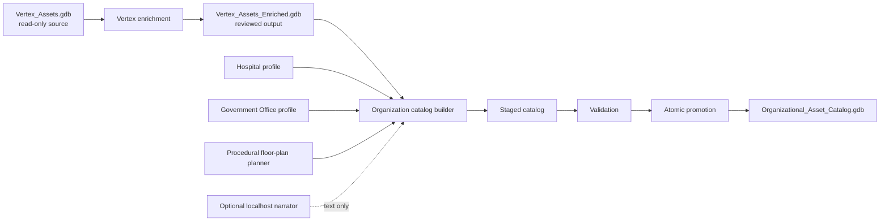

# ArcGIS Indoors Asset Catalog Workflow Report

**Reporting date:** October 1, 2026

**Scope:** Vertex enrichment and six-facility organizational catalog

## Executive Summary

The project creates deterministic synthetic asset-management data on top of an ArcGIS Indoors hierarchy. It supports realistic dashboard, related-record, replacement-planning, and knowledge-graph demonstrations without modifying the original source geodatabase or asserting that synthetic records represent actual equipment.

The workflow has two controlled outputs:

1. `Vertex_Assets_Enriched.gdb` preserves the reviewed Vertex Medical Center hierarchy and 1,003 assets while adding lifecycle planning and operational history.
2. `Organizational_Asset_Catalog.gdb` imports that reviewed Vertex slice and adds four procedurally generated hospitals plus Admin HQ.

The promoted catalog contains 6 Sites, 6 Facilities, 32 Levels, 1,025 Units, 4,852 indoor lifecycle assets, 72 exterior assets, 20,376 inspections, 922 repairs, 1,913 work orders, and 6,590 system-dependency links. Validation found zero orphan references.

## Objectives and Outcomes

| Objective | Outcome |
| --- | --- |
| Protect the original Indoors source | `Vertex_Assets.gdb` is always read-only; all writes go to new geodatabases |
| Enrich an existing facility | All 1,003 Vertex assets receive deterministic lifecycle and history data |
| Scale to an organization | Five additional facilities use deterministic procedural plans and explicit asset profiles |
| Preserve reproducibility | Business IDs and allocation derive from stable hierarchy keys, profiles, and seeds rather than rebuild-specific GlobalIDs |
| Support ArcGIS relationships | Asset points, lifecycle rows, and history tables use validated GlobalID/GUID relationships |
| Add optional narrative variety | A localhost LLM can write bounded text only; deterministic fallback guarantees complete output |
| Make replacement safe | Catalog builds are staged, validated, and atomically promoted; validated staging is reusable after a lock failure |

## End-to-End Workflow



### Stage 1: Source Protection and Preflight

The workflow validates Sites, Facilities, Levels, Units, business parent fields, and room-use values before writing. The source geodatabase is never edited. Outputs are written beside the source in separate file geodatabases.

### Stage 2: Vertex Enrichment

The Vertex workflow adds deterministic lifecycle, temporal, financial, warranty, risk, inspection, repair, and work-order data. The reviewed output contains:

- 1,003 indoor assets and 10 exterior assets.
- 4,154 inspections.
- 271 repairs.
- 501 work orders, including 451 completed and 50 active records.
- Exact lifecycle cohorts of 201 recently installed, 501 within service life, and 301 at retrofit/replacement.

### Stage 3: Procedural Organization Construction

The catalog builder imports Vertex from the reviewed enriched output. The imported business values, geometry, history, and narratives are preserved while geodatabase-owned relationship GUIDs are remapped.

Point Place, Line Lake, Node North, and Rohdran Cove use the Hospital profile. Admin HQ uses the Government Office profile. A standard-library planner creates deterministic footprints, corridors, room programs, names, use types, capacities, and amenities. ArcPy converts the plan to polygons and places each facility at a synthetic geographic anchor.

No CAD/BIM model, manual room inventory, third-party geometry library, or external planning tool is required.

### Stage 4: History, Relationships, and Narratives

Every indoor asset has one lifecycle record. History rows carry both `AssetLifecycleGlobalID` and `AssetPointGlobalID`, enabling lifecycle analysis and direct related records from the asset map layer. System-dependency rows support graph edges to HVAC, electrical, IT, medical gas, fire alarm, emergency power, plumbing, and related systems.

The optional LLM receives bounded synthetic facts and can write only short narrative fields. IDs, dates, costs, conditions, statuses, cohorts, geometry, and relationships remain deterministic.

### Stage 5: Validation and Promotion

The builder verifies hierarchy identities, parentage, room programs, geometry containment, business-key continuity, date bounds, lifecycle cohorts, relationship GUIDs, imported Vertex preservation, and zero fabricated integration/media links.

The notebook writes a staging geodatabase first. After validation, it atomically renames workspaces to promote the catalog. If ArcGIS Pro holds a lock, the validated staging catalog remains available and is reused after references to the old catalog are closed.

## Validated Portfolio

| Facility | Type | Units | Indoor assets | Exterior assets |
| --- | --- | ---: | ---: | ---: |
| Vertex Medical Center | Reviewed hospital | 286 | 1,003 | 10 |
| Point Place | Generated hospital | 114 | 648 | 13 |
| Line Lake | Generated hospital | 114 | 644 | 18 |
| Node North | Generated hospital | 120 | 658 | 9 |
| Rohdran Cove | Generated hospital | 128 | 736 | 11 |
| Admin HQ | Generated business center | 263 | 1,163 | 11 |
| **Total** |  | **1,025** | **4,852** | **72** |

The organization-wide lifecycle distribution is 970 recently installed, 2,426 within service life, and 1,456 at retrofit/replacement.

## Data and Relationship Model

```text
Site -> Facility -> Level -> Unit -> IndoorAssetLocation -> AssetLifecycle
                                                        -> Inspection
                                                        -> Repair
                                                        -> WorkOrder
                                                        -> SystemDependency

Facility -> ExteriorAssetPoints
```

GlobalIDs and GUIDs are authoritative relationship keys inside each geodatabase. Stable business identity uses `Facility_ID|Level_ID|Unit_ID` for indoor allocation and `Facility_ID` for exterior allocation. Rebuilding with the same hierarchy, profile, and seed preserves business asset IDs and quantities even though file-geodatabase GlobalIDs may change.

External-reference, field-work-link, and media-reference tables are intentionally empty. They define integration contracts without fabricating portal items, enterprise records, URLs, credentials, or media.

## Deterministic and LLM Responsibilities

| Deterministic Python | Optional local LLM |
| --- | --- |
| IDs and hierarchy | Inspection narrative wording |
| Geometry and placement | Repair narrative wording |
| Asset quantities and classes | Work-order narrative wording |
| Lifecycle dates and cohorts | No authority over business facts |
| Conditions, criticality, costs, warranty, and risk | Strict one-field JSON response |
| Relationships and validation | Maximum 500 characters |

The promoted catalog recorded 5,912 narrative opportunities, 500 requests sent, 498 accepted responses, two request-error fallbacks, and 5,412 budget fallbacks. Deterministic fallback text completed every rejected, unavailable, or over-budget narrative.

## Controls and Quality Evidence

- Original source remains unchanged.
- Exact Site, Facility, Level, Unit, and asset identities are validated.
- Procedural Unit polygons are checked for containment and non-overlap.
- All lifecycle and history foreign keys are checked.
- Inspection dates are constrained to September 28, 2021 through March 28, 2026.
- Purchase dates precede commissioning and purchase costs remain below replacement estimates.
- Warranty and risk values are evaluated against the September 28, 2026 reference date.
- Direct asset-history relationship classes support asset popup workflows.
- The non-schema automated suite contains 59 passing tests.
- Production schema and full catalog validation completed in the ArcGIS Pro notebook kernel.

## Operational Guidance

Use ArcGIS Pro 3.7.2 for production schema and catalog runs. Configure repository and source paths in the notebook input cell and matching builder constants. Keep generated geodatabases, manifests, logs, and model weights outside the Git checkout.

For Vertex-only enrichment:

```python
RUN_VERTEX = True
RUN_CATALOG = False
ALLOW_OVERWRITE = False
```

For the full organizational catalog:

```python
RUN_VERTEX = False
RUN_CATALOG = True
ALLOW_OVERWRITE = True
```

Before catalog promotion, remove layers and standalone tables using the old catalog, close their attribute tables, and close Catalog views browsing inside it.

## Use Cases

- ArcGIS Dashboard portfolio summaries and facility comparisons.
- Floor-aware maps with related inspections, repairs, and work orders.
- Asset replacement, warranty, risk, and maintenance planning demonstrations.
- Knowledge-graph exploration of assets, facilities, and supporting systems.
- Training and testing with repeatable data that contains no production credentials or enterprise IDs.

## Boundaries and Recommendations

The catalog is synthetic demonstration data, not a real equipment inventory. Procedural plans are plausible but do not reconstruct actual buildings. Utility-network assets, credentials, hosted forms, image binaries, and live enterprise records are outside scope.

Recommended next actions:

1. Publish selected asset and history layers together with their relationship classes.
2. Configure floor awareness and related-record popups.
3. Build portfolio and replacement-planning dashboard views.
4. Model system-dependency records as graph relationships.
5. Decide whether Vertex enrichment should become an additional toolbox tool.

## Related Deliverables

- [Catalog and Enrichment Guide](catalog_and_enrichment_guide.md)
- [Organizational Catalog Data](organizational_catalog_data.md)
- [Notebook Workflows](arcgis_pro_notebook_workflows.md)
- [Schema](schema.md)
- [Local LLM Integration](llm_integration.md)
