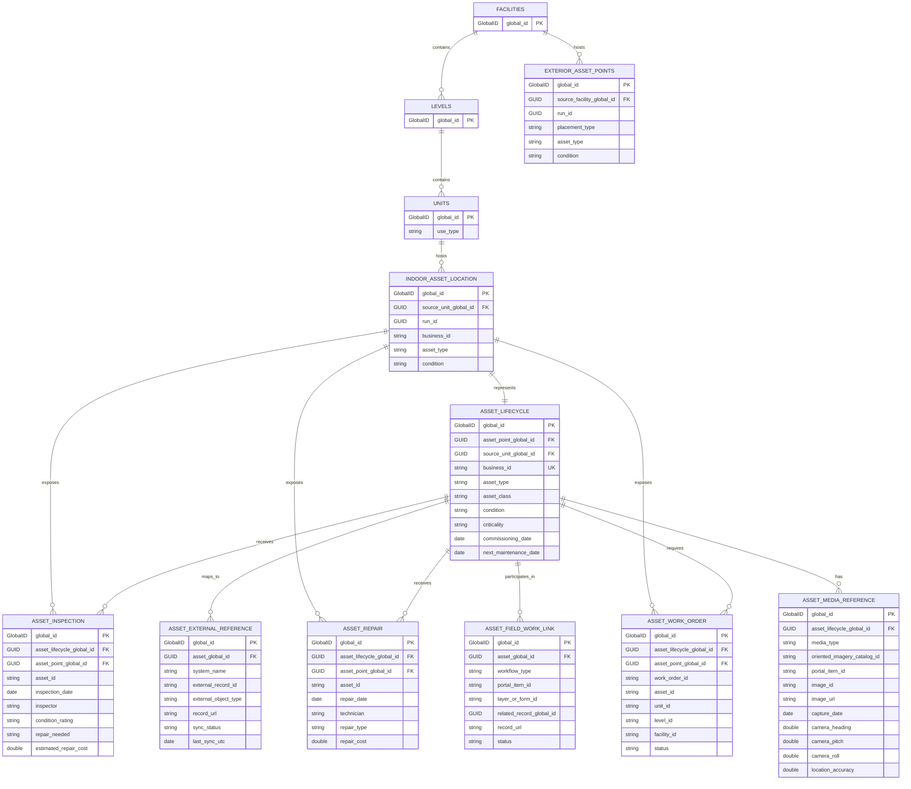

# Indoors Demo Asset Schema

For the exact dataset, field-population, domain, relationship, contingent-value, and attribute-rule delta between the original medical Indoors geodatabase and the generated single-facility output, see [Vertex Assets Geodatabase Delta](vertex_assets_gdb_delta.md).

`Facilities`, `Levels`, and `Units` remain ArcGIS Indoors-owned source records. The generator creates the `AssetManagement` feature dataset and its asset-management records in the copied output geodatabase.

## Inspection Workflow

`Inspect Indoors Geodatabase` produces a versioned JSON decision record for a selected source geodatabase and facility profile. Its `inspection` section is intended for review: compatibility, Unit and room-use counts, mapped and unmapped `USE_TYPE` values, and a recommended action. Full field, domain, relationship, and imagery discovery remains available in `technical_details`.

`Generate Demo Assets` can consume this report when the report source path, selected profile name, and profile version match its inputs. It uses the report to make profile coverage visible before it writes. It always repeats minimum live-source validation immediately before copying the geodatabase, because an inspection report cannot prove that the GDB has not changed.

Live-source validation requires `Sites`, `Facilities`, `Levels`, and `Units`, together with their business-key parent fields (`SITE_ID`, `FACILITY_ID`, `LEVEL_ID`, and `UNIT_ID`) and `Units.USE_TYPE`. This prevents a source from passing preflight when the hierarchy needed for generation is incomplete.

## Integration Workflow

`Integrate Generated Assets` combines generated records with a target Indoors workspace without modifying either input. It creates a new output geodatabase by copying the target and then recreates the generator-owned `AssetManagement` schema in that output.

Before it writes, the tool verifies that every `SourceUnitGlobalID` in generated indoor assets exists in the target `Units` class, and that every `SourceFacilityGlobalID` in generated exterior assets exists in the target `Facilities` class. It rejects a missing parent reference instead of creating orphaned records.

File geodatabases create new GlobalIDs during record insertion. The tool therefore remaps generated location and lifecycle GlobalIDs in the new output and updates all dependent lifecycle foreign keys before validating the completed relationships. This preserves the target Indoors hierarchy and leaves the generated and target input geodatabases unchanged.

GlobalIDs remain authoritative relationship keys, but they are not stable generation inputs because a copied or rebuilt file geodatabase assigns new values. Deterministic allocation instead uses business identities: `Facility_ID|Level_ID|Unit_ID` for indoor assets and `Facility_ID` for exterior assets. Rebuilding the same facility with the same profile, hierarchy, and seed therefore preserves generated asset IDs, quantities, and allocation. Relationship rows are remapped to the current output GlobalIDs, so consumers must not use old GlobalIDs as cross-build identifiers.

| Input | Action | Result |
| --- | --- | --- |
| Generated demo GDB | Read-only source of generated records | Remains unchanged |
| Target Indoors GDB | Copied before changes | Remains unchanged |
| New integrated GDB | Receives copied target and remapped generated records | Standalone integrated workspace |

## Facility Profiles

The tool selects assets through a versioned facility profile. A profile maps `Units.USE_TYPE` values to explicit templates; it does not infer a room type. Every template controls its asset type, asset class, quantity range, criticality, maintenance interval, and system dependencies.

| Profile | Intended coverage | Asset examples |
| --- | --- | --- |
| Hospital | General hospital Indoors data with core clinical and building spaces | hospital beds, patient monitors, operating tables, imaging modalities, exam tables, HVAC equipment, switchgear, network racks, fire/life-safety equipment, exterior lighting and security cameras |
| Vertex | Enhanced Hospital profile for the supplied Vertex medical facility; covers all discovered `USE_TYPE` values | all Hospital asset types plus pre-op stretchers, recovery beds, procedure tables, treatment chairs, laboratory analyzers, medication refrigerators, pharmacy workstations, therapy equipment, office workstations, meeting-room displays, parking lighting, and elevator control panels |
| Government Office | General office and public-service spaces | office workstations, security equipment, IT/network hardware, building services, electrical equipment, and exterior lighting |

`Vertex` includes generic, common clinical assets where the source has a clinical use without a specific equipment inventory. For example, pre-op and post-op rooms receive preparation/recovery furniture and patient-monitoring assets; treatment, pediatric, psychiatric, outpatient, and infusion spaces receive treatment chairs, vital-signs monitors, and clinical handwash sinks. These are pseudo-assets for demonstration, not an asserted facility equipment inventory.

### Vertex Source Coverage

The Vertex profile explicitly maps the supplied source uses into these template groups:

| Source-use group | Vertex template group | Typical generated assets |
| --- | --- | --- |
| Pre-Op, Post-Op, Endoscopy | Preparation, recovery, procedure | stretchers, recovery beds, procedure tables, monitors |
| Cardiology, Pediatrics, Infusion, Outpatient, Psychiatric | Clinical specialty or treatment | treatment chairs, diagnostic workstations, handwash sinks |
| Laboratory, Pharmacy, Rehabilitation | Department-specific clinical support | lab analyzers, medication refrigerators, therapy equipment |
| Office, Doctor Office, HR, Billing, Mail, Copy, Phone | Office or clinical office | workstations, office furniture, wall diagnostic sets |
| Admission, Entry Lobby | Reception | desks, workstations, access-control readers |
| Meeting, Training | Meeting room | video conferencing systems, presentation displays |
| Kitchen, Nutrition, Locker Room, Lounge, Break Room | Staff or food service | lockers, commercial refrigerators, handwash sinks |
| Restroom, Storage, Medical Records | Support services | plumbing fixtures, shelving, records storage/workstations |
| Elevator, Parking Garage, Outdoor Space, Open to Below | Transport or common area | elevator control panels, parking lighting/cameras, common-area lighting |
| Fire Closet, Mechanical, Electrical, Telecom, Janitorial, Stairway | Building infrastructure | fire panels, air handling units, switchgear, network racks, mop sinks, emergency lights |

## Integration Bridges

`AssetExternalReference` is an open, vendor-neutral mapping table. A single asset can have zero or many rows: for example, one Salesforce `Asset` reference and one IBM Maximo `ASSETNUM` reference. `SystemName` and `SyncStatus` are coded domains; `ExternalObjectType`, `ExternalRecordID`, and `RecordUrl` remain intentionally open to support other enterprise asset/resource-management systems. Store endpoint URLs, OAuth tokens, passwords, and other credentials outside the geodatabase.

`AssetFieldWorkLink` bridges an asset to ArcGIS field workflows. It supports either `ArcGIS Inspection` or `Survey123`, identifies the target portal item and layer/form, and can store the related inspection/Survey123 GlobalID once a response exists. The application integration is deferred: these records are safe link contracts, not a claim that the toolbox publishes forms or calls ArcGIS Online.

`AssetMediaReference` is a one-to-many link from an asset to `OrientedImage`, `Panorama360`, `Photo`, or `Document` records. It stores a reference to an ArcGIS Oriented Imagery Catalog item or a secured external image, together with optional capture and camera-orientation metadata. Images themselves and credentials are not stored in the geodatabase.

## CSV Source Alignment

The generated `AssetLifecycle` and location records mirror the supplied `Asset_Data_from_AMS.csv`, `Critical_Indoor_Assets.csv`, and `Medical_Equipment.csv` contract: `Asset_ID`, category/subtype fields, make/model/serial, owner, maintainable/fixed flags, criticality rating, `Unit_ID`, `Level_ID`, `Facility_ID`, `Site_ID`, barcode, photo URL, and height. GlobalIDs remain the authoritative geodatabase relationship keys; business keys remain available for straightforward import/export.

The populated `Category_Code`, `Category_Type`, `Subtype_Code`, and `Category_Subtype` values use the project's versioned synthetic taxonomy (`asset-type-usd-v1`). They classify the existing `AssetClass` and `AssetType`; the short codes are not asserted to be AMS, manufacturer, or other enterprise codes. Apply an authoritative crosswalk before exporting these values into a production asset-management system.

`AssetInspection`, `AssetRepair`, and `AssetWorkOrder` mirror the supplied `Inspections.csv`, `Repairs.csv`, and `Work_Orders.csv` fields. Each row has both `AssetLifecycleGlobalID` and `AssetPointGlobalID`. The first preserves lifecycle-centered analysis; the second directly relates the row to `IndoorAssetLocation`, making history available from asset-layer popups without traversing the intermediate lifecycle table.

When publishing, include `IndoorAssetLocation`, all three history tables, and their relationship classes in the same feature service. Configure related-record elements in the web map or application popup after publishing; the geodatabase relationships supply the association but do not automatically design the popup.

Generated `Unit_ID`, `Level_ID`, `Facility_ID`, and `Site_ID` text fields inherit their lengths from the corresponding source Indoors hierarchy fields when available. In particular, `AssetManagement/IndoorAssetLocation.Level_ID` must match `Indoors/Levels.LEVEL_ID` for ArcGIS Pro to configure the asset layer as floor aware without a field-length warning.

## Enriched Asset Profile

The Vertex enrichment workflow adds deterministic planning fields to `AssetLifecycle`. These values are synthetic and internally consistent; they are intended for dashboard filtering, replacement planning, warranty analysis, and prioritization rather than as claims about real equipment.

| Field group | Fields | Contract |
| --- | --- | --- |
| Lifecycle | `LifecycleStage`, `ExpectedLifeYears`, `AssetAgeYears`, `RemainingLifeYears`, `ReplacementDueDate`, `ReplacementYear` | Dates and ages derive from the configured reference date and class-specific expected life range |
| Inspection/maintenance | `LastInspectionDate`, `OverdueDays`, `MaintenanceIntervalDays`, `AnnualMaintenanceCost` | Latest inspection matches related history; maintenance interval comes from the asset template |
| Financial | `EstimatedReplacementCost`, `PurchaseDate`, `PurchaseCost` | Replacement estimates use deterministic USD bands keyed by exact `AssetType`; purchase precedes commissioning and purchase cost is 62-92% of replacement estimate |
| Procurement/warranty | `Vendor`, `WarrantyExpirationDate`, `WarrantyStatus` | Vendor and warranty assumptions are deterministic; warranty status is evaluated at the reference date |
| Risk | `RiskScore`, `RiskLevel` | Score is 0-100 and combines criticality, condition, lifecycle stage, and maintenance lateness; levels are Low, Moderate, High, or Critical |

Pricing bands are synthetic planning assumptions, not vendor quotations or live market-price research. They represent equipment replacement and exclude taxes, freight, installation, service contracts, configuration, and regional adjustments. Inspection repair estimates and historical repair costs are deterministic percentages of the same type-level replacement estimate.

## Integrity Controls

| Dataset | Controlled fields | Integrity mechanism |
| --- | --- | --- |
| `AssetLifecycle` | `AssetClass`, `Condition`, commissioning and maintenance dates | coded domains, AssetClass/Condition contingent values, and an Arcade constraint attribute rule |
| `ExteriorAssetPoints` | `PlacementType`, `Condition` | coded domains |
| `AssetExternalReference` | `SystemName`, `SyncStatus` | coded domains; indexed AssetGlobalID and external record ID |
| `AssetFieldWorkLink` | `WorkflowType`, `Status` | coded domains; indexed AssetGlobalID |
| `AssetInspection` | `Condition_Rating`, `Repair_Needed` | coded domains; indexed lifecycle and asset-point GlobalIDs |
| `AssetRepair` | parent references | indexed lifecycle and asset-point GlobalIDs |
| `AssetWorkOrder` | `Status` | coded domain; indexed lifecycle and asset-point GlobalIDs |
| `AssetMediaReference` | `MediaType` | coded domain; indexed AssetLifecycleGlobalID |

The generator places attached assets on the related Facility boundary. Exterior assets use a scale-relative outward buffer from that boundary, so they remain outside the Facility polygon in either projected or geographic coordinate systems.