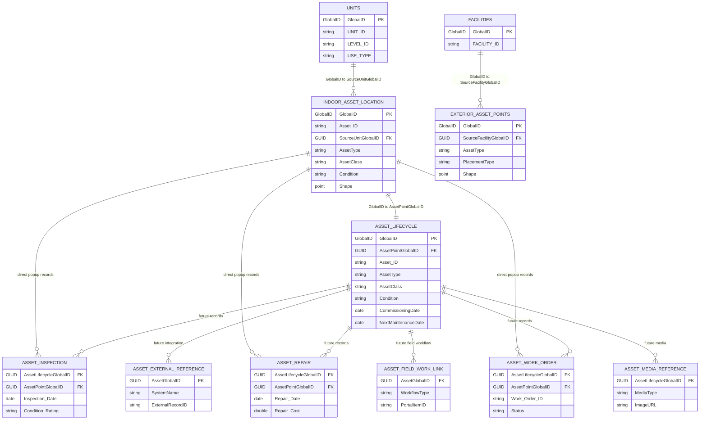

# Vertex Assets Geodatabase Delta

This document describes the earlier generation step that created the base `Vertex_Assets.gdb`. It does not describe the later lifecycle/history enrichment in `Vertex_Assets_Enriched.gdb`; see [Catalog and Enrichment Guide](catalog_and_enrichment_guide.md) for that workflow.

It compares the input Indoors geodatabase:

`C:\Workspace\Sandbox\data\ILM_asset_gen\Medical Indoors_3141f0\commondata\medical_facility_indoors.gdb`

with the generated single-facility output:

`C:\Workspace\Sandbox\data\ILM_asset_gen\Medical Indoors_3141f0\GDBs\Vertex_Assets.gdb`

The output is a copy of the input. The generator does not add fields to or update records in the existing Indoors feature classes. It adds a separate asset-management schema and relates it to the copied `Units` and `Facilities` classes through GlobalIDs.

## Schema Diagram

## Added Layers And Tables

| Dataset | Type | Rows in Vertex output | Purpose |
| --- | --- | ---: | --- |
| `AssetManagement/IndoorAssetLocation` | Point feature class | 1,003 | One point at the source Unit label point for each generated indoor asset |
| `AssetManagement/ExteriorAssetPoints` | Point feature class | 10 | Attached and exterior assets placed on or just outside the Facility boundary |
| `AssetLifecycle` | Table | 1,003 | One descriptive and lifecycle record for each indoor asset point |
| `AssetInspection` | Table | 0 | Schema for future inspection history |
| `AssetRepair` | Table | 0 | Schema for future repair history |
| `AssetWorkOrder` | Table | 0 | Schema for future work orders |
| `AssetExternalReference` | Table | 0 | Links to future Maximo, Salesforce, or other enterprise records |
| `AssetFieldWorkLink` | Table | 0 | Links to future ArcGIS Inspection or Survey123 records |
| `AssetMediaReference` | Table | 0 | Links to future photos, documents, panoramas, or oriented imagery |

All nine datasets receive a system-managed `GlobalID`. The two point feature classes are inside the new `AssetManagement` feature dataset and use the source Units spatial reference.

## Fields And Population

### IndoorAssetLocation

| Fields | Population in this run |
| --- | --- |
| `GlobalID`, `Asset_ID`, `Unit_ID`, `Level_ID`, `Barcode`, `SourceUnitGlobalID`, `RunID`, `BusinessID`, `AssetType`, `AssetClass`, `Condition`, geometry | Populated for generated rows |
| `Facility_ID`, `Site_ID` | **Empty (`NULL`) for all 1,003 generated rows.** The source `Units` class does not expose these optional denormalized fields to the generator |
| `Photo_URL`, `Height` | **Empty (`NULL`) for every generated row** |

`Barcode` and `BusinessID` currently receive the same deterministic business identifier.

### ExteriorAssetPoints

`GlobalID`, `SourceFacilityGlobalID`, `RunID`, `BusinessID`, `AssetType`, `AssetClass`, `PlacementType`, `Condition`, and geometry are populated. There are no intentionally empty business fields on generated exterior rows.

### AssetLifecycle

| Fields | Population in this run |
| --- | --- |
| `GlobalID`, `Asset_ID`, `Name`, `Description`, `Maintainable`, `Fixed`, `Criticality_Rating`, `Unit_ID`, `Level_ID`, `Barcode`, `AssetPointGlobalID`, `SourceUnitGlobalID`, `RunID`, `BusinessID`, `AssetType`, `AssetClass`, `Condition`, `Criticality`, `CommissioningDate`, `NextMaintenanceDate` | Populated for generated rows |
| `Facility_ID`, `Site_ID` | **Empty (`NULL`) for all 1,003 generated rows** because those optional values were not available from source `Units` |
| `Category_Code`, `Category_Type`, `Subtype_Code`, `Category_Subtype` | **Empty (`NULL`) for every generated row** |
| `Make`, `Model`, `Serial`, `Owner` | **Empty (`NULL`) for every generated row** |
| `Photo_URL`, `Height` | **Empty (`NULL`) for every generated row** |

The empty fields are intentional extension points for enterprise asset data, imagery, and physical specifications. They are not generation failures.

### Empty Child Tables

Because `AssetInspection`, `AssetRepair`, `AssetWorkOrder`, `AssetExternalReference`, `AssetFieldWorkLink`, and `AssetMediaReference` contain zero records, **every business field in those tables is presently empty**. Their fields are:

| Table | Fields awaiting records |
| --- | --- |
| `AssetInspection` | `AssetLifecycleGlobalID`, `AssetPointGlobalID`, `Asset_ID`, `Asset_Type`, `Inspection_Date`, `Inspector`, `Condition_Rating`, `Repair_Needed`, `Notes`, `Estimated_Repair_Cost`, `Repair_Type` |
| `AssetRepair` | `AssetLifecycleGlobalID`, `AssetPointGlobalID`, `Asset_ID`, `Asset_Type`, `Repair_Date`, `Technician`, `Repair_Type`, `Notes`, `Repair_Cost` |
| `AssetWorkOrder` | `AssetLifecycleGlobalID`, `AssetPointGlobalID`, `Work_Order_ID`, `Request_Type`, `Request_Date`, `Description_of_Issue`, `Asset_ID`, `Asset_Type`, `Unit_ID`, `Level_ID`, `Facility_ID`, `Facility_Name`, `Assignee`, `Status` |
| `AssetExternalReference` | `AssetGlobalID`, `RunID`, `SystemName`, `ExternalRecordID`, `ExternalObjectType`, `RecordUrl`, `SyncStatus`, `LastSyncUTC` |
| `AssetFieldWorkLink` | `AssetGlobalID`, `RunID`, `WorkflowType`, `PortalItemID`, `LayerOrFormID`, `RelatedRecordGlobalID`, `RecordUrl`, `Status` |
| `AssetMediaReference` | `AssetLifecycleGlobalID`, `MediaType`, `OrientedImageryCatalogID`, `PortalItemID`, `ImageID`, `ImageURL`, `CaptureDate`, `CameraHeading`, `CameraPitch`, `CameraRoll`, `LocationAccuracy` |

## Added Domains

| Domain | Assigned fields | Codes |
| --- | --- | --- |
| `AssetCondition` | `IndoorAssetLocation.Condition`, `ExteriorAssetPoints.Condition`, `AssetLifecycle.Condition` | Operational; Maintenance Due; Offline Repair |
| `AssetClass` | `AssetLifecycle.AssetClass` | Building Services; Clinical Equipment; Communications Equipment; Diagnostic Equipment; Electrical Equipment; Fire and Life Safety; Furniture; IT Equipment; Plumbing Equipment; Security Equipment |
| `AssetPlacementType` | `ExteriorAssetPoints.PlacementType` | Exterior; Attached |
| `YesNo` | `AssetLifecycle.Maintainable`, `AssetLifecycle.Fixed`, `AssetInspection.Repair_Needed` | Y; N |
| `CriticalityRating` | `AssetLifecycle.Criticality_Rating` | 1 through 5 |
| `InspectionCondition` | `AssetInspection.Condition_Rating` | Excellent; Good; Fair; Poor; Fail |
| `WorkOrderStatus` | `AssetWorkOrder.Status` | Open; Assigned; In Progress; On Hold; Completed; Closed |
| `ExternalSystem` | `AssetExternalReference.SystemName` | Salesforce; IBM Maximo; Other |
| `IntegrationSyncStatus` | `AssetExternalReference.SyncStatus` | Not Configured; Pending; Synchronized; Error |
| `FieldWorkWorkflow` | `AssetFieldWorkLink.WorkflowType` | ArcGIS Inspection; Survey123 |
| `FieldWorkStatus` | `AssetFieldWorkLink.Status` | Not Started; In Progress; Complete; Closed |
| `AssetMediaType` | `AssetMediaReference.MediaType` | OrientedImage; Panorama360; Photo; Document |

## Added Relationships

All relationships are simple relationships using GlobalID/GUID keys.

| Relationship | Cardinality |
| --- | --- |
| `Units_IndoorAssetLocations` | Unit 1:M indoor asset points |
| `Facilities_ExteriorAssetPoints` | Facility 1:M exterior asset points |
| `IndoorLocations_AssetLifecycle` | Indoor asset point 1:1 lifecycle record |
| `AssetLifecycle_Inspections` | Lifecycle asset 1:M inspections |
| `AssetLifecycle_Repairs` | Lifecycle asset 1:M repairs |
| `AssetLifecycle_WorkOrders` | Lifecycle asset 1:M work orders |
| `IndoorLocations_Inspections` | Indoor asset point 1:M inspections for map popups |
| `IndoorLocations_Repairs` | Indoor asset point 1:M repairs for map popups |
| `IndoorLocations_WorkOrders` | Indoor asset point 1:M work orders for map popups |
| `AssetLifecycle_ExternalReferences` | Lifecycle asset 1:M enterprise references |
| `AssetLifecycle_FieldWorkLinks` | Lifecycle asset 1:M field-work links |
| `AssetLifecycle_MediaReferences` | Lifecycle asset 1:M media references |

Relationships to empty tables are valid schema but have no child records yet.

## Attribute Rule And Contingent Values

`AssetLifecycle` receives one editable constraint attribute rule:

- **Name:** `AssetLifecycleDateOrder`
- **Triggers:** Insert and update
- **Error number:** 1001
- **Constraint:** When both dates are populated, `CommissioningDate` must not be in the future and `NextMaintenanceDate` must be later than `CommissioningDate`. If either date is empty, the rule allows the row.

It also receives the `AssetClassCondition` field group. Every configured asset class is allowed with each of the three `AssetCondition` codes. This establishes the contingent-value framework without further restricting a particular class/condition pairing.

## Added Indexes

Indexes accelerate the GlobalID relationships and common lookups:

- Source Unit, source Facility, and asset-point foreign keys
- Lifecycle `Asset_ID`
- Inspection, repair, work-order, and media parent GUIDs
- External-reference parent GUID and external record ID
- Field-work parent GUID

## What Did Not Change

The generation tool first copies the complete input GDB and then creates the datasets above in the copy. It does not add fields to, delete rows from, or update the existing `Indoors`, `Indoors3D`, `IndoorNetwork`, validation, or network-analysis datasets. The source GDB remains unchanged.
